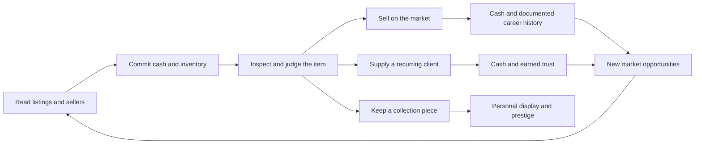

# Project Flip: a trading career worth returning to

Design review · 22 October 2026 · source checkpoint `f846183`

**Recommendation:** make Project Flip about becoming a trusted specialist dealer with a collection and client history of their own. Cash funds that career; it does not define success. Build on the existing market, inspection, negotiation, resale and saved-event systems. Do not add a separate management game.

**Status: proposal only. No gameplay implementation is authorized by this document.** It does not replace the master brief or reopen the paused implementation queue.

## Evidence and limits

I inspected the domain models, catalog, purchase/inspection/repair/resale/buyer engines, knowledge and valuation rules, profile and trading views, persistence and timed actions, plus current design and playtest records. I also reviewed the recorded normal-release marketplace image at `../../Artifacts/GameInterface-2026-10-22/normal-release.png`. Live UI inspection was attempted but computer-control permission was unavailable; this is a source-and-recorded-evidence review, not a fresh playthrough.

The companion [current-state audit](PROGRESSION_CURRENT_STATE_AUDIT.md) provides source references. The most relevant existing records are [current status](STATUS.md), [fairness corrections](FAIR_TRADING.md), [category knowledge](INSPECTION_KNOWLEDGE.md), [item findings](ITEM_FINDINGS.md), [market simulation](MARKET_SIMULATION.md), [living marketplace](LIVING_MARKETPLACE.md) and [human playtest protocol](HUMAN_PLAYTEST.md).

The owner has reported both predictable/easy trading and, after tuning, random/frustrating trading. The later fairness correction supersedes the earlier buyer-withdrawal design: a modest first counter no longer loses a buyer by coin flip. These observations matter more than speculation about what players ought to enjoy. Automated tests demonstrate working rules, not first-week retention.

All suggested frequencies, milestones, thresholds and durations below are **initial design hypotheses**, not measured retention findings or implementation specifications. Day labels mean opportunities across voluntary sessions, never calendar locks or login requirements.

## 1. What the current game actually motivates

The primary motivation is finding an apparent mispricing, committing under uncertainty, resolving the item's condition and turning it into a positive receipt. Category learning adds a second, functional incentive. That is a promising transaction game. It is not yet a sustained career.

| Question | Current answer | Consequence |
| --- | --- | --- |
| Why make another trade? | More cash, a potentially better deal, another knowledge point | Success mostly feeds the same activity |
| What changes when richer? | More simultaneous purchases and affordable services; fixed inventory still constrains | Risk becomes less personally consequential without a new destination |
| Does wealth unlock new decisions? | No implemented market/career access ladder; all three categories already appear | Larger stakes are not currently a new market world |
| Reasons to care about one item? | Fictional model, condition, category findings, acquired costs and outcome | Evidence differentiates goods; little persistent attachment survives sale |
| Collection value? | Retro is a category, not an implemented collection system | No keep-versus-sell emotional objective |
| Prestige? | No earned career titles, collection displays or competitive layer | Profit has no lasting public-facing identity |
| Mastery? | Genuine seller reading, price/risk judgment and category inspection progression | Strongest existing foundation; finite mechanical ceiling |
| Identity? | Player can prefer a category; profile shows cash/capacity, knowledge and history | Specialization is behavior, not recognized identity |
| Meaningful loss? | Cash losses, service costs, held inventory, missed deals and lost buyers | Real downside exists, but severity depends on remaining bankroll |
| Anticipation? | Replies, delivery, reports, offers, watchlist changes, trends and replenishment | Mostly minutes/hours; few personally important multi-session projects |
| Career/endgame? | No implemented long-term destination or branching milestones | The player eventually has to invent all reasons to continue |

### Why the loop may become boring

1. **Success can consume its own challenge.** Starting cash is 20,000 economy units. Catalog base values range from 1,500 to 16,800. Thus the starting wallet exceeds every individual model's base value, although an asking price may exceed base value. The proposed cheap-to-premium climb is not already present in these numbers. See [balance configuration](../ProjectFlip/Core/GameBalanceConfig.swift), [catalog](../ProjectFlip/Resources/SeedData/items.json).
2. **Information progression runs out.** Knowledge ranks are reached at 0/3/8/16 XP per category. A first self-inspection gives one point; a first expert completion gives two. Self-check then expert on the same item can produce three points. Six such items can therefore reach rank three; sixteen self-only items also suffice. Rank three plus tools can reveal current category facts/faults. This is useful advancement, but not a weeks-long content plan. See [knowledge](../ProjectFlip/Domain/InspectionKnowledge.swift), [inspection](../ProjectFlip/Simulation/InspectionEngine.swift).
3. **Services get relatively cheap.** Expert inspection is a flat 150; permanent kits cost 350/500/400. At the highest base value the report costs under 1%, versus 10% at the lowest. Reports happen after purchase, so they cannot erase acquisition risk, but increasing wealth makes post-purchase certainty inexpensive. Rank progression further reduces dependence on reports.
4. **Risk becomes procedural.** If the player can tolerate a bad purchase easily and learn almost everything after purchase, the remaining problem can become patiently converting stock to cash. Negotiation variation alone cannot carry a month of play.
5. **Products leave no personal legacy.** Selling an exceptional camera and an ordinary camera differs economically, but neither advances a relationship, display or chosen career objective.
6. **Timers promise outcomes, not purpose.** A pending buyer gives a reason to check soon. It does not answer why this buyer or item matters next week.
7. **The catalog is broad but structurally finite.** Fifty definitions do not equal fifty different strategies. Many share the same buy/check/price flow; theme changes alone will not extend mastery.

There is no evidence establishing the exact boredom hour. Test for the first repetition signal within the first five to ten non-introductory trades and across day-one/day-three/day-seven returns. Do not report “players churn after two hours” without observations.

## 2. Choose the fantasy

> I started with a small bankroll and no name. Now people trust my judgment in the markets I know, come to me for difficult finds, and recognize the pieces I chose to keep.

This fits the existing marketplace-first game because identity emerges from sourcing, evidence, pricing and capital decisions.

| Direction | Fit | Decision |
| --- | --- | --- |
| Respected specialist dealer | Excellent: knowledge, sellers, buyers and history already exist | Primary fantasy |
| Collector / rare opportunity hunter | Strong: fictional goods and authenticity/completeness evidence exist | Optional parallel aspiration |
| High-value market progression | Strong only if risk and deal structure change | Add access gradually; never just multiply prices |
| Best trader / category master | Strong as self-improvement | Recognize demonstrated judgment, avoid a global grind level |
| Client problem-solver | Strong: makes ordinary inventory personally useful | Primary source of authored continuity |
| Trading empire | Weak now: implies staffing, premises, automation and management | Defer; do not convert the game into a shop simulator |
| Competitive ranking | Useful amplification later | Optional; not the source of purpose |

The player starts as an unknown independent trader with useful seed capital, not literally penniless. The aspirational destination is a respected specialist with difficult clients, advanced access, a recognizable showcase and a record of sound decisions. There is no single compulsory collection or required all-category completion.

## 3. Five connected systems, not a second game

### 1 — Career record, trust and market access

**Problem solved:** successful trading currently has no destination. **Motivation:** competence, status, entering a more demanding world.

Use the existing reputation field as a visible trust measure, plus a small set of permanent career milestones derived from documented actions. Do not add a second spendable reputation currency or general player XP bar. Initial career names: Independent Trader → Recognized Dealer → Established Specialist. Collector and Private Dealer distinctions follow later.

Career eligibility should recognize completed, evidence-backed transactions and fulfilled commitments. It must not require every trade to be profitable. A player who takes an honest loss can still earn trust. Ordinary-sale and client routes must both reach V1 access milestones; collectors must not have to surrender collection pieces to advance.

Reputation initially governs **who is willing to transact and under what evidence requirements**, not automatic price premiums. Current buyer budgets, sale delays and seller floors already read reputation; activating it unchanged would stack monetary and liquidity advantages. Reassess those coefficients together. Prefer bounded trust effects and different deal sources over “higher rank = richer buyers.”

There is a crucial limitation: current resale has no player-controlled honesty/disclosure system, and buyer pricing reads actual item truth. A reputation morality meter would be fake without observable player choices. For V1, attach trust only to explicit, verifiable commitments and documented condition. State what information is unknown; never punish a player for an undiscoverable defect, shipping handled automatically by the game, ordinary haggling, rejecting a buyer, or missing an unaccepted request. Deliberate concealment, disputes and refunds belong in a later coherent information design, not a random penalty bolted onto this one.

The first specialist invitation can require knowledge rank one and a small portfolio of varied, documented trades, with a client fulfillment as an alternative proof. Exact counts should be tuned after playtests; use diverse cases rather than “sell 20 items.” Do not charge an entrance fee simply to delay players. Wealth provides purchase capacity, not sole eligibility.

**Scope/cost:** medium-high: milestones, trustworthy reputation events, access filters, UI and save migration. V1: local plus specialist opportunities, two meaningful promotions. V1.1: collector market. Later: private deals. **If omitted:** cash remains the practical career scoreboard.

### 2 — Category mastery that improves interpretation

**Problem solved:** the game's best existing progression ends quickly and is buried under Profile. **Motivation:** learning and confidence in a chosen specialty.

Keep the three current tracks and tools. Bring the next capability into the trading journey: “Next camera rank lets you interpret shutter and autofocus tests with your kit.” Show why a completed inspection changed the next decision. A player should notice learning through better judgment, not merely a point toast.

Do not stretch the 16-point track into 160 points. Do not grant exact deal ratings, guaranteed authenticity from a badge, pre-purchase omniscience or universal margin bonuses. Existing rank-three inspection can continue to diagnose the current standard catalog; future advanced opportunities should add genuinely new provenance/completeness/liquidity decisions rather than secretly nerfing old tools.

Recognize a specialty through the player's record: investigated camera cases, varied model experience and supplied camera clients. Let the player choose a displayed title such as Camera Specialist, Retro Hunter or Electronics Dealer. They can change it freely; all knowledge persists. Titles are not classes and have no income multiplier.

A V1 specialist market can combine the current condition findings with stricter buyer requirements and slower audiences. V1.1 provenance work needs its own evidence and content; “more obscure defects” alone is not a new strategy.

**Scope/cost:** low-medium for capability communication and derived identity; high for genuinely new advanced evidence. V1: surface existing mastery and one earned specialty title. V1.1: deepen evidence. **If omitted:** existing knowledge still works, but players may not connect it to a career; advanced progression risks being cosmetic price scaling.

### 3 — A small recurring client roster

**Problem solved:** every buyer is an interchangeable payout. **Motivation:** being needed, continuity and difficult sourcing goals.

Start with two recurring fictional buyers and three authored requests each. Use the existing inbox and item evidence. One camera buyer wants equipment fit for different uses; one retro buyer cares about compatible, complete original goods. They remember the previous delivery and explain the next requirement. Their relationships unlock later requests, not another numeric relationship currency.

A retro arc could go from a compatible Chapter handheld, to a complete original example, to a documented unusual edition in V1.1. The third V1 request should use available standard goods; do not silently depend on the unimplemented prototype system.

Each request states accepted models or substitutes, known condition/evidence requirements, fixed payout, acceptance terms and whether there is a deadline. Request previews are not expiring appointments. Begin with no deadline, then offer optional accepted commitments measured in generous active play or clearly disclosed calendar time. Do not punish a player for returning three days later to an offer they never accepted. A delivery deadline starts only on acceptance; include inspection/delivery requirements in feasibility.

Requests must be solvable from plausible supply. Accept alternatives, let the player discuss a substitution, and retain a follow-up route when the market is dry. Do not spawn a cheap matching item immediately after every acceptance. Do not offer a mandatory rare-RNG request with a deadline.

A client payout **replaces** the resale proceeds. It is not proceeds plus a quest bag of money. Quote a fixed, bounded price from ordinary willingness-to-pay and the request's standards; exclude the player's purchase price from payout calculation. This prevents buy-high subsidy exploits. Client demand is occasional and specific, not a guaranteed buyer for every item.

Two requests being available creates a sourcing decision; twenty objective cards create administration. V1 permits one accepted request at a time while other clients can be revisited. Failures lose that opportunity and delay the next commission, with an explicit retry route; they do not reset the relationship history.

**Scope/cost:** high despite reusable events: NPC writing, eligibility, evidence matching, alternatives, offline behavior, localization and payout balancing. V1: two clients/six requests. V1.1: deeper branches and accepted time commitments. **If omitted:** career exists, but few items matter to anyone beyond their resale value.

### 4 — Curated ownership, with occasional remarkable finds

**Problem solved:** cash is fungible and selling erases attachment. **Motivation:** authorship, discovery, pride and choosing what money is for.

V1 should have two small three-piece displays built from existing fictional catalog families. Proposed sets: **Chapter Generations** (Chapter 8, Chapter 16, Chapter Color) and **Focal Trio** (Focal 24, Focal 35, Focal 80). These are proposed curatorial themes, not claims that the current game already has this lore. Define relevant standards: a repaired working example can qualify for one theme; another may prize original parts and packaging. Avoid making pristine condition universally correct.

The player chooses which set to pursue and can ignore both. A good first piece is recognizable without elite tools. Collection entries explain why each model belongs, with a few authored lines about the fictional product world's development. Do not add a hundred blank silhouettes.

Ownership matters: a completed active display requires the actual items. Selling a piece removes it from the active display and releases cash. A historical completion badge remains as an honest record, but there is no repeat completion reward. Show both “assembled before” and “currently displayed,” so keeping a set has meaning after its first completion.

Keep the eight trading slots. Add at most six dedicated display positions for these initial sets: no generic warehouse expansion. Displayed items retain their locked-up acquisition capital and cannot be sold/repaired until moved back into a free trading slot. Otherwise the display becomes free overflow storage. Cosmetics and paid supporter options must never enlarge functional display/storage capacity. Collection rewards are a title, a shelf presentation or a profile frame, never large cash or a permanent margin bonus.

A keep/sell dilemma should use the actual scale of the economy. A Chapter Color has a base value of 7,800 today: keeping a desirable example can tie up a meaningful part of the initial 20,000 bankroll. The user's hypothetical 80,000 handheld belongs to a future authored market, not the current catalog.

Rare variants belong to the same ownership system rather than a separate loot tier. Start in V1.1 with a few legible launch editions, documented colorways or intact provenance bundles. Current retro `.edition` is always `.standardEdition`; a boxed standard item is not already a rare variant. Signed items and prototypes need fictional provenance and distinct art/evidence, not just a gold label.

**Initial discovery hypotheses:** a particularly good ordinary opportunity every 5–10 seriously evaluated candidates; a notable collectible approximately every 30–50 distinct eligible listings; a genuinely scarce variant approximately every 150–250 eligible listings. These are supply design targets, not three independent reward rolls. Validate exposure and reachable paths in real sessions. With a ten-slot replenishing feed, calendar rarity and player-observed rarity differ sharply.

Never gate the first V1 sets behind the scarce-variant odds. Major prototypes should conclude discoverable sourcing leads or an optional long client arc, not require thousands of refreshes. Long absence must not count as thousands of failed rolls; existing catch-up already bounds feed replenishment. Save item truth when created, preserve it on reload and never sell paid rerolls. A missed piece can have a later sourcing route; missing one listing is not permanent account loss.

Discovery should be evidence-led: recognize a marking, ask a seller, test it, then confirm the find. It can be fairly priced, damaged, expensive to authenticate or hard to sell. Rarity is not a universal profit multiplier. Ordinary stock remains the reliable source of working capital and client fulfillment.

**Scope/cost:** medium-high for V1 ownership and two sets; high for variants with coherent art, truth, provenance and supply. V1: standard-item collections. V1.1: modest variants. Later: prototypes. **If omitted:** status can progress, but players still lack a durable reason to sacrifice money for a particular object.

### 5 — Portfolio pressure and recovery

**Problem solved:** wealth can trivialize consequences, while a bad start can stop participation. **Motivation:** strategic resourcefulness and recovering through better judgment.

Preserve the existing eight-slot inventory including reserved shipments, cash commitments, paid services and category liquidity differences. Keep the purchase preview of remaining cash. Add a concise portfolio reading of available cash, committed capital and items awaiting decisions; do not present unknown inventory valuation as guaranteed net worth.

Do not initially add listing slots, repair slots, rent, energy, durability decay or loans. Repairs are immediate today. A repair queue would be a substantial design change and is only justified if human sessions show an interesting scheduling choice rather than more waiting.

Use access to expand capital decisions. For a future player with 30,000, a 10,000 ordinary flip, 22,000 evidence-sensitive camera and 28,000 scarce collectible should compete for the same bankroll. They need different uncertainty, likely sale audience and outside uses, not three differently colored profit bars. Avoid scaling every new asking price to the wallet; that would make getting rich feel meaningless. Lower markets remain useful and affordable.

V1 needs a recovery floor before progression can ask players to risk more. Proposed first route: an explicit as-is wholesale liquidation quote below plausible market proceeds, returning cash and a slot without pretending it was a win. For a player left with insufficient trading capital after liquidation, offer a small **consignment recovery deal**: no purchase outlay, one supplied ordinary item, fixed modest sourcing/sale commission, proceeds owned by the consignor. It occupies capacity and awards no farmable career milestone or collection credit. Available only while below a recovery-capital threshold; it cannot lift the player into wealth and never requires an ad. Do not count consigned principal as profit. These routes require separate balancing and are not currently implemented.

Career history, knowledge, kits and earned cosmetics survive financial failure. An accepted client failure can cost that commission and some local trust, but basic market access remains. Recovery restores participation, not the lost upside. Rare inventory must not become a required sacrifice before an otherwise viable recovery route exists.

**Scope/cost:** medium-high: liquidation quotation, consigned ownership/accounting, safeguards and UI. V1: minimum recovery path and existing-capacity clarity. V1.1: deeper portfolio tooling if needed. **If omitted:** high-risk progression may be toothless for rich players and a soft lock for poor ones.

## 4. Goal horizons that reinforce one another

| Horizon | Goal | Trading decision it creates | Lasting payoff |
| --- | --- | --- | --- |
| Minutes | Investigate one questionable listing | Which evidence matters before committing? | Better judgment and a possible good purchase |
| Minutes | Accept a standing offer or make the clearly limited counter | Is extra margin worth delaying this sale? | Cash or an understandable missed opportunity |
| Minutes | Repair, sell as-is or keep | Is the service cost justified by demand and purpose? | Capital, client suitability or display progress |
| Several sessions | Become capable with camera tests | Which item/report teaches something useful? | A real inspection capability |
| Days of voluntary play | Supply a recurring buyer | Which model meets the requirement at a defensible price? | Trust and the next relationship chapter |
| Days of voluntary play | Assemble a three-piece display | Which opportunity is worth keeping capital tied up in? | Ownership and a visible identity |
| Weeks | Qualify for collector/private opportunities | Can I evaluate harder evidence while preserving working capital? | A new type of deal |
| Weeks/months | Build a chosen specialist career and signature collection | Which high-stakes commissions and finds define my trader? | Authored legacy, optional mastery and ongoing projects |

There is no need for a separate daily mission layer. A trade can advance cash, knowledge and a relationship, but should not shower the player with all reward types every time. A rejected bad deal can also serve a goal by preserving capital; do not force every meaningful decision into an XP grant.

## 5. Progression must change the question

| Stage | Market situation | New question | Requirement before adding it |
| --- | --- | --- | --- |
| Local / beginner | Current affordable goods, obvious clues, introductory faults | Can I recognize a plausible margin and avoid an avoidable mistake? | Existing loop feels fair at production pacing |
| Specialist / V1 | Camera and retro evidence, category buyers, mixed liquidity | Does this item meet an intended use, and is waiting worth it? | Knowledge visibility, evidence-matching clients, trust |
| Collector / V1.1 | Original parts, completeness and authenticated variants | What exactly is this item, and who actually wants it? | Variant truth, provenance evidence and distinct demand |
| Premium / later | Large commitments, professional counterparties, scarce audiences | Is this concentration of capital defensible? | Long-run economy tests and new deal structures |
| Private / later | Introductions and specific high-value commissions | Which relationship and opportunity should I commit scarce resources to? | Mature clients, trust and fair recovery |

Implement these as market sources/filters in the existing marketplace, not five unrelated apps. Keep at least half of a basic ten-listing feed usable for ordinary trading during early progression; specialist invitations should expand choice rather than replace all accessible goods. Do not expose all five locked destinations on the first screen.

Do not lock all cameras/retro behind long category gates: they already provide early variety, and existing saves already own them. Gate specialist sources and unusually demanding opportunities, not the right to learn a whole category. Advanced market access also cannot require collection completion; that would turn optional keeping into a mandatory cash sink.

A specialist market made entirely of more expensive stock is not ready to ship. Each tier must pass a simple test: describe one decision that did not exist in the preceding tier without mentioning money amounts.

## 6. Risk, fairness and recovery must scale together

| Risk | Existing footing | Recommended progression behavior |
| --- | --- | --- |
| Hidden faults | Stable hidden truth, seller clues and knowledge-limited checks | Harder evidence combinations; never invent faults at inspection |
| Dishonest sellers | Different seller beliefs, honesty and asking behavior | More subtle but readable contradictions, not all elite sellers lying |
| Negotiation failure | Patience/final offers; later fairness correction | Preserve understandable boundaries; do not reintroduce random first-counter loss |
| Repairs | Immediate quotes; some services cost more than recovery | Client or collection requirements can change whether repair is worthwhile |
| Market timing | Bounded 5–12% noncompounding demand movements | Keep forecasts contextual; no surprise total-market collapse |
| Liquidity | Category audience, price-sensitive traffic, expiry/relisting | Specific collector audiences and opportunity cost, not uniformly longer timers |
| Capital concentration | Cash debit and eight slots including shipments | Visible alternatives and cash remaining, no forced minimum reserve |
| Reputation | Static field with pricing/attention hooks | Only causal, visible commitment outcomes; no penalties for losses or unknowable truth |
| Missing an opportunity | Competitor purchases and feed lifecycle | Missed transaction matters; whole career remains possible |

A valuable purchase should threaten the player's available options, not erase years of acquired capabilities. Scale risk as a share of available capital and information uncertainty. Do not target a mandatory loss percentage: a skilled player is allowed to win consistently by choosing safer trades.

After a loss, the receipt should answer “what cost me money?” using earned facts: purchase, report, repair and sale proceeds; observed condition and known market timing. It must not assert a hidden causal explanation it cannot establish. Preserve the current signed ledger. Tool purchases are operating expenses outside item receipts today; a future career overview must not mislabel the sum of trade receipts as total business profit after tools.

## 7. Reward economy: small, purposeful and bounded

Only four persistent progress concepts are needed:

1. **Cash:** the only spendable currency. Funds acquisitions, existing services/tools and optional collecting.
2. **Trust:** existing reputation made actionable; not spendable, not awarded for sheer transaction value.
3. **Category knowledge:** the existing three tracks; no separate overall level.
4. **Owned collection progress:** actual qualifying pieces plus historical achievements; not token fragments.

Career titles/access are derived milestones. Relationships are remembered chapters. Neither needs another currency.

| Reward | Purpose | Functional or cosmetic? | Limit |
| --- | --- | --- | --- |
| Net resale/client proceeds | Fund the next decision | Functional | One payout per item; no quest cash stacked on sale |
| Knowledge/capability | Understand more evidence | Functional | Unique first learning events; no repeat recheck farming |
| Trust / career milestone | Access and recognition | Functional access + visible identity | Distinct documented cases, no profit multiplier |
| Tools | Exercise earned diagnostic capability | Functional | Existing one-time cash purchase; no paid-money version |
| New deal source | Different uncertainty/audience | Functional | Not guaranteed bargains or higher expected profit everywhere |
| Client continuity | Personal reason to source | Functional opportunity + narrative | Limited relevant requests, not a universal disposal service |
| Collection title/frame/display art | Express chosen ownership | Cosmetic/prestige | No massive completion cash, passive income or rarity boost |
| Rare physical item | A meaningful choice to keep, supply or sell | Item value + emotional value | Condition, evidence and demand still matter |
| Achievements/themes | Mark memorable milestones | Cosmetic | Secondary recognition; no chores built to fill a badge page |

**Frequent:** each meaningful negotiation, reveal or settled trade provides useful feedback; only actual learning earns knowledge. **Medium:** aim for the first capability improvement or client payoff over a few sessions, and a chosen display piece or specialist milestone over the first week. **Major:** collection completion, new source access or an exceptional confirmed find; ordinarily one headline event in a session at most. This is a presentation ceiling, not a schedule that withholds legitimate accomplishments.

Avoid stacked confetti, rarity jingles on ordinary stock, streak rewards and random prize rolls. Suspense comes from committing to a particular item with uncertain evidence. Do not move the reward cadence into a casino-style reveal machine.

The current economy can keep its 20,000 starter wallet while the design is tested. Do not cut it reflexively to manufacture a climb. Test starter capital against the price bands and number of simultaneous choices; decide whether it prevents overexposure or trivializes early tradeoffs using actual sessions. Later advanced stock needs authored values and audiences, not unlimited inflation.

## 8. First week and return reasons

| Time | Intended player-owned goal | Concrete session content | Why return? |
| --- | --- | --- | --- |
| Day 1 | Make a defensible first flip and choose an interest | Existing signaled fault; repair/as-is choice; explicit costs; preview next category capability after learning | A known shipment/report/offer and a named next learning goal |
| Day 2 | Apply what I learned | Compare at least two opportunities; keep room for delivery; meet first recurring client without forced acceptance | See whether the sourced item fits this buyer |
| Day 3 | Become useful to someone / make first identity choice | Complete a reachable request or equivalent documented-trade milestone; choose a display goal or specialty | Follow-up request or a specific missing model, not a login bonus |
| Day 4 | Handle a trade that does not go perfectly | Reprice, decline uneconomical repair or accept a loss if it occurs naturally | Recover available capital and make a better next decision |
| Day 5 | Recognize a new kind of opportunity | Specialist invitation based on earned evidence; do not require an unusually lucky drop | Try the different buyer requirement or audience |
| Day 6 | Decide what to keep | First plausible collection piece; compare cash tied up with another opportunity | Hunt a named second piece or improve the active display |
| Day 7 | Finish a self-selected small arc | First client chapter, specialist promotion or a small display; no promise everyone completes all three | The next client problem or a clearly described collector ambition |
| Day 30 | Have a recognizable career and an unfinished ambition | V1.1 collector source, several differentiated clients and optional variant sourcing if validated | A difficult commission, signature collection or new specialty |

These are pacing targets, not seven forced lessons. Someone playing twice a week receives the same opportunities. The present human playtest guide still contains older “minutes” wording for replies; current fairness code/doc sampling is 30–90 seconds before urgency scaling, and buyer attention is 60–180 seconds before price/category scaling. Delivery is roughly 3–7 minutes, expert reports 15 minutes, and sale listings have a 45-minute window. Actual time-to-sale is not guaranteed. Use production pacing when testing this journey.

**Tomorrow:** a buyer with a remembered need, a delivered item to assess, and a saved choice of which model to keep. Existing short timers can support the visit but cannot be the entire promise.

**Three days later:** the request preview and collection goal remain available. Expired market listings have real outcomes, and a later alternative can be sourced. No streak was lost; no unaccepted commission harmed trust.

**One week later:** the player still knows the milestone they were building toward. A progressed specialty or new client chapter offers a different requirement. A market theme can vary what is useful, but should not erase the player's chosen project.

A 45-minute sale window that repeatedly expires while someone is away may make “come back tomorrow” feel like cleanup. Observe relisting friction and missed firm offers before lengthening everything. If this is a repeated problem, test a persistent resale intent with bounded offer windows and paused repricing decisions; do not add passive offline money. That is a later testable change, not an assertion that current timers already support daily retention.

## 9. Endgame and multiple motivations

Endgame is choosing increasingly consequential trades in service of a personal dealer identity: maintain a signature display, fulfill a difficult collector arc, develop a second specialty, or pursue strong realized results while preserving liquidity. Basic markets remain useful working-capital sources. No prestige reset confiscates ownership or erases expertise.

Profit-oriented players can specialize in turnover and risk-adjusted returns. Collectors can fund holdings through ordinary trade. Rare hunters can follow sourcing leads. Relationship-oriented players can favor commissions. Knowledge-oriented players can explore multiple categories. Their opportunities overlap, but no path supplies a unique mandatory income buff that makes it the correct answer for everyone.

**Honest scope limit:** two small displays, two clients and two promotions are a V1 test of this architecture, not credible months of authored content. A Day-30 promise requires V1.1 evidence-rich markets and additional differentiated client/collection content, and may still fail in playtests. Do not pad the gap with larger XP requirements, endlessly inflated items or weekly chores. A satisfying finite first career is preferable to an empty infinite promise.

## 10. Game Center and monetization later

Game Center should recognize an already interesting offline game. Proposed later Weekly Market Challenge: a separate optional portfolio with equal starting funds, a shared scenario seed/catalog, bounded trade opportunities and an explicit end valuation rule. Main-save wealth, tools, paid options and collection rewards must not improve this starting position. It must be playable locally without sign-in; online participation only adds comparison.

Prefer a small lexicographic result: solvent portfolios first, then net realized result after all operating costs, with risk rules fixed by the scenario. Disclose the unsold inventory rule in advance; prohibit end-of-week inventory dumping exploits or finish with a conservative scenario liquidation. Do not reward the largest lifetime wallet or most hours refreshing. Achievements and friend comparisons can reflect verified milestones; award cosmetic recognition only.

This is a design direction, not a claim about any currently supported GameKit challenge API. Offline saves and clock normalization do not provide robust competitive integrity. Shared scenarios, replay validation, score submission and version consistency need a separate technical investigation before promising credible rankings. No backend is required for the current single-player value proposition, and no competitive implementation belongs in this task.

Monetization must remain outside the economic loop. Do not sell cash, knowledge, trust, slots, client priority, better evidence, authenticity certainty, timer skips, rare odds or recovery. Rewarded inspection/speed boosts suggested in the older brief conflict with the stricter no-progression-purchase principle here and should be deferred/rejected under this proposal.

Later rewarded ads could offer optional cosmetic previews or a purely visual profile treatment also earnable through ordinary milestones. They cannot help the player reach a deal first or earn a competitive score. If there is no cosmetic ad reward worth offering, omit rewarded ads; they are not a requirement to distort progression around. Supporter cosmetics are a cleaner fit. Remove Ads should remove actual optional future ad placements under clearly stated terms; do not introduce interruption ads to make that purchase useful. No premium currency or streak economy is needed.

## 11. Prioritized recommendations

Scores are design judgments, not measured forecasts. Player/retention impact: 10 = highest potential benefit. Cost: 10 = largest implementation/content/QA effort. Risk: 10 = greatest balance, scope or player-experience uncertainty. “V1” is a proposed release scope, not permission to implement.

| Priority / proposal | Player impact | Retention impact | Cost | Risk | V1 importance | Dependencies |
| --- | ---: | ---: | ---: | ---: | --- | --- |
| 1. Career/trust + one specialist source | 9 | 9 | 7 | 6 | Essential | Documented outcome rules; audit existing reputation bonuses; save migration |
| 2. Two recurring clients / six requests | 9 | 9 | 7 | 6 | Essential | Item evidence, payout rules, persistent client identity, reachable supply |
| 3. Two small owned collections | 8 | 8 | 6 | 5 | Essential emotional layer | Ownership/display rules, chosen targets, catalog qualification, capital accounting |
| 4. Surface existing mastery + flexible title | 8 | 7 | 3 | 3 | Essential foundation; integrate with 1 | Current knowledge/tools and recorded unique cases |
| 5. Portfolio clarity + minimum recovery | 8 | 7 | 6 | 6 | Essential safeguard | Existing ledger, liquidation quote, consignment ownership and anti-farming rules |
| Collector tier and advanced provenance | 9 | 8 | 8 | 7 | V1.1 | Validated first-week architecture, new evidence and audience behavior |
| A few meaningful rare variants | 8 | 8 | 7 | 7 | V1.1 | Collections, immutable variant truth, art/lore, supply and valuation tests |
| Resale-window change if return sessions demand it | 7 | 8 | 5 | 6 | Conditional tuning | Observed relisting friction; saved-event/offer semantics |
| Cosmetic milestones and supporter appearance | 5 | 4 | 3 | 3 | Minimal earned set in V1; paid later | Real achievements and accessible presentation |
| Premium/private sources and long client arcs | 8 | 8 | 9 | 8 | Later | Collector-stage validation, differentiated content, recovery |
| Local weekly scenario → Game Center comparison | 6 | 7 | 8 | 8 | Later | Valuable offline loop, isolated economy, integrity/version research |
| Rewarded cosmetic ads / Remove Ads | 2 | 2 | 5 | 6 | Later; optional | Suitable cosmetic value, explicit terms, no economic advantage |

### Top three systems to implement next, if this design is approved

1. **A minimal career/trust path that earns one genuinely different specialist source.** Use existing knowledge as evidence, show one next ambition, and avoid stacked reputation profit boosts. Include basic recovery as a release prerequisite, not an unrelated milestone delayed indefinitely.
2. **Two recurring clients with ordinary, evidence-sensitive requests.** These turn knowledge and capital into concrete personal goals. Prove that supplying a buyer is a real sourcing decision rather than a guaranteed-profit quest.
3. **Two three-piece collections using existing standard items.** Make keeping something compete with working capital; reward expression and historical recognition. Do not make this depend on rare variants first.

First test the current loop's corrected fairness and pacing; then evaluate these additions one at a time. This order is not a request to implement all three together. Knowledge communication and portfolio clarity belong inside the relevant slices rather than becoming extra standalone systems.

### Deliberately do not implement yet

Auctions, shop premises/staff, empire automation, a general XP level, permanent specialization classes, big rarity ladders, mandatory daily/weekly missions, login streaks, repair/listing slot economies, rent/debt/bankruptcy resets, randomly assigned morality penalties, prototype jackpots, competitive cash prizes, Game Center, paid economic advantages and monetization infrastructure. Each adds burden before proving the career has a worthwhile destination.

### Biggest current retention risk

**The player becomes competent and financially comfortable before forming an attachment or unfinished ambition.** The next transaction works, but does not change what the player cares about. More timer variety will not solve that.

### Biggest progression risk

**A career ladder that removes uncertainty while multiplying returns.** If trust improves prices, speed and deal quality while knowledge removes all informational risk and advanced markets only cost more, progression becomes a solved wealth escalator. The second risk is mandatory breadth: forcing every player through clients, all categories and collections creates a chore route. Keep parallel proofs and optional aspirations.

### Recommended reward economy

Cash for real settlement; existing category knowledge for unique learning; trust for kept, observable commitments; collection ownership for emotional value. Functional rewards open new questions and counterparties. Titles, frames, themes and completion prestige express achievement. No passive income, completion windfalls, general profit buffs, paid certainty, second currency or ad-gated rescue.

### Recommended first-week journey

**Understand one trade → learn one useful capability → become useful to a recurring buyer → choose something worth keeping → qualify for a meaningfully different opportunity.** A player can reach these at their own pace and take losses along the way.

“One more trade” means the next decision could fund a specific piece, satisfy a client or demonstrate a capability. “Tomorrow” means a remembered buyer, a concrete pending item and a chosen hunt. “Next week” means an attainable dealer identity and a more demanding opportunity the player already understands.

## 12. What would validate or reject this design?

Use the existing human-playtest process; no analytics SDK is required for this decision. Observe a fresh first session and voluntary returns around day three and day seven. Record actual production-paced sessions and continuing saves; do not force a rare find or rescue a stalled run invisibly.

Ask players, before showing a menu of aspirations: “What are you trying to achieve now?”, “Why did you choose this listing?”, “What are you saving or keeping money for?”, and “What would bring you back?” Record their own words and a concrete trade.

The architecture earns further investment if players can name a goal beyond cash, pursue it through different sourcing choices, understand a failure, and voluntarily resume an unfinished ambition. It fails if they farm cheap inspections for a badge, use clients as guaranteed resale machines, feel required to complete collections, stop taking thoughtful risks, or return only to clear expired listings. Evaluate varied preferences rather than expecting every tester to become a collector.

Before collector/private expansion, inspect the continuing economy: cash alongside committed stock, realized results after operating expenses, report use by category/rank, time and friction to sell, concentration of purchases, source of career advancement and recovery frequency. Check whether richer players still face meaningful alternatives and whether poor players can recover. These observations should determine numerical tuning and V1.1 scope.

**Decision requested for a later review:** whether this specialist-dealer architecture is the right direction, and which first slice should be specified. This review stops at analysis. No new systems, economy changes, Game Center work or monetization have been implemented.
