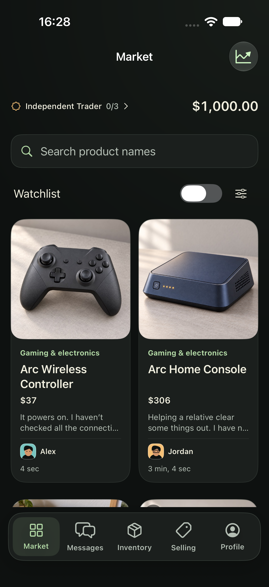
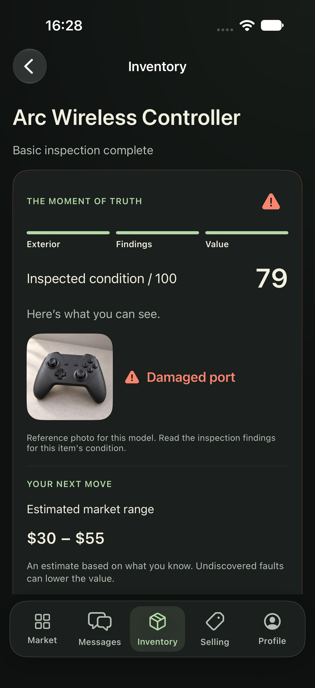
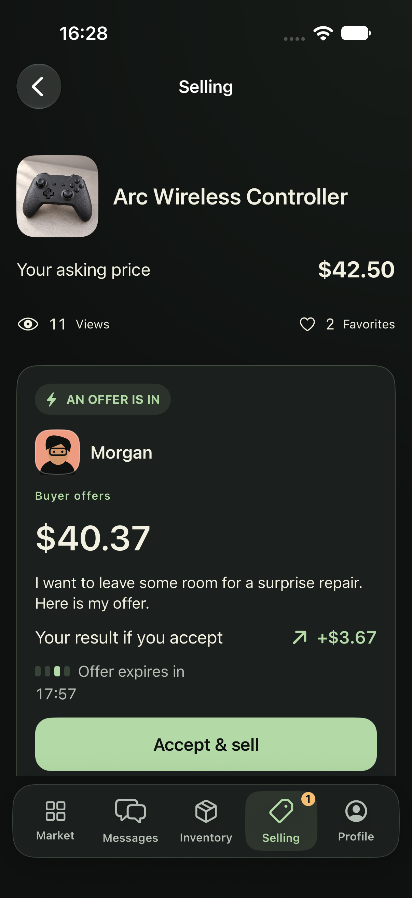

<p align="center">
  
</p>

<h1 align="center">Pazlume</h1>

<p align="center"><strong>Find the overlooked. Inspect the risk. Make the next great trade.</strong></p>
<p align="center">An offline secondhand trading game for iPhone, built with Swift and SwiftUI.</p>
<p align="center">iOS 26+ · Swift 6 · Six languages · No ads or in-app purchases</p>

<p align="center">
  
  
  
</p>

## Every bargain has a story

A seller says it works. The photos look promising. The price leaves room for profit—or an expensive surprise.

Browse the market, ask questions and negotiate a deal. Inspect what arrives, decide which repairs are worth the cost, and list it for resale. Read the buyer, watch the clock and learn from the receipt. An estimate is a clue; the final sale tells the story.

## Play your own trading career

- **Hunt for overlooked stock.** Discover 80 fictional products across six categories. Search, filter, bookmark and follow a changing market with competing traders and occasional price drops.
- **Choose your repairs.** Uncover faults through inspection, compare repair plans and spend only where the decision makes sense.
- **Make the deal.** Negotiate with sellers and buyers, review quiet listings and compare your own previous sales when setting a price.
- **Build lasting contacts.** Six recurring clients offer eighteen connected requests with condition requirements, budgets and cosmetic honors.
- **Learn your market.** Unlock products and diagnostic tools through career progress. A category trade notebook tracks actual costs, proceeds and profit or loss, with detailed receipts.
- **Try a fresh challenge.** Weekly Flip uses a separate bankroll and market, with local scores and eleven local achievements.

Pending deliveries, replies and offers advance when you return. Progress stays on device, with verified backups and an explicit recovery flow for damaged saves.

## Built for offline play

No login, developer backend, advertising, analytics or real-money economy. Products, conversations and cash are fictional. Notifications are optional. Weekly Flip and achievements work locally; online Game Center is currently disabled.

Available in **English, Turkish, German, French, Spanish and Italian**, with support for Dynamic Type and Reduce Motion. The catalog uses 56 bundled photographs, with some shared product-family images; artwork provenance is documented in [the documentation index](Docs/INDEX.md).

## Run locally

1. Open `ProjectFlip.xcodeproj` in Xcode with an installed iOS 26 or later SDK and iPhone simulator.
2. Select the **ProjectFlip** scheme and an iPhone simulator, then run.
3. For a physical iPhone, configure your Apple development team and signing first.

The public name is currently **Pazlume**. Internal target names, bundle identity and save paths retain **ProjectFlip** to preserve compatibility. New name candidates are tracked in [the naming shortlist](Docs/NAME_OPTIONS_2026_10_26.md).

## Verify

```sh
bash Scripts/verify.sh
```

This validates all six localization catalogs and bundled assets, runs unit and UI tests, checks for recorded runtime warnings, then builds Release for iPhone. Set `TEST_DESTINATION` to choose a simulator and `RESULT_ROOT` to retain results in a specific directory. The [GitHub Actions workflow](.github/workflows/verify.yml) runs the same checks; no remote passing status is claimed here.

The latest gameplay checkpoint passed **202 unit tests**, with focused native UI acceptance for six-language trading, trade history, price learning, client sourcing and large text. See [the exact verification scope](Docs/GAMEPLAY_EXPANSION_2026_10_25.md); overlapping checkpoints are not a new complete-suite result. Physical-device and unassisted human playtesting remain outstanding.

## Explore the project

| Area | Contents |
| --- | --- |
| [`ProjectFlip/Domain`](ProjectFlip/Domain) | Items, negotiations, career progression, clients and settled trade records |
| [`ProjectFlip/Simulation`](ProjectFlip/Simulation) | Pricing, buyers, repairs, market arrivals and scheduled events |
| [`ProjectFlip/Persistence`](ProjectFlip/Persistence) | Local saves, migrations, validated backups and recovery |
| [`ProjectFlip/UI`](ProjectFlip/UI) | SwiftUI screens, adaptive layouts and game presentation |
| [`ProjectFlipTests`](ProjectFlipTests) / [`ProjectFlipUITests`](ProjectFlipUITests) | Domain regressions and native gameplay journeys |
| [`Release`](Release) | Six-language store copy, reviewer notes and static privacy/support pages |

## Project status

In development toward its first App Store release. A current unsigned device archive and store materials have been prepared locally. Public support/privacy deployment, Apple distribution signing and App Store submission are still pending.

[Documentation](Docs/INDEX.md) · [Development checklist](Docs/DEVELOPMENT_TODO.md) · [Release setup](Release/README.md) · [Playtest guide](Docs/HUMAN_PLAYTEST.md)

Support: [bilgenburak@outlook.com](mailto:bilgenburak@outlook.com)
